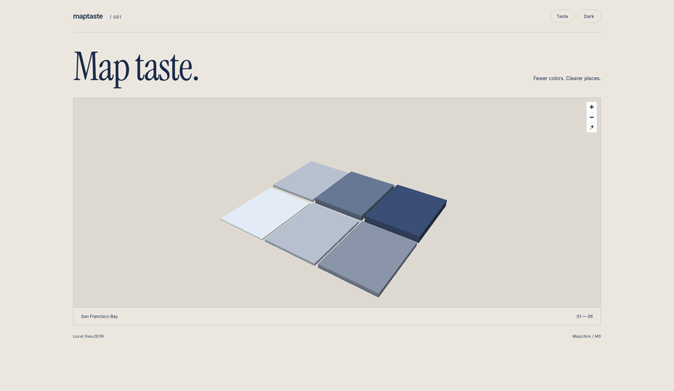
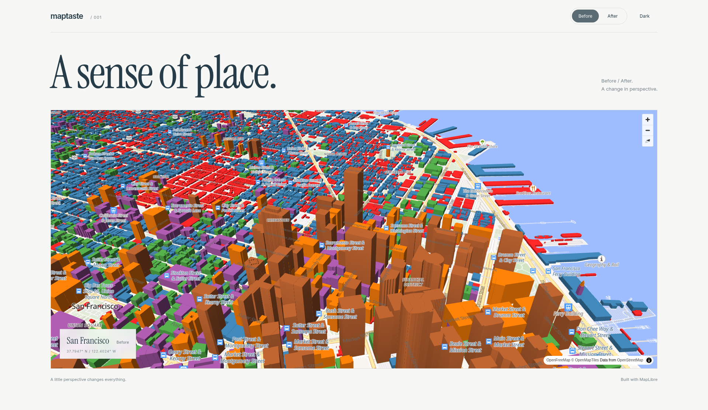
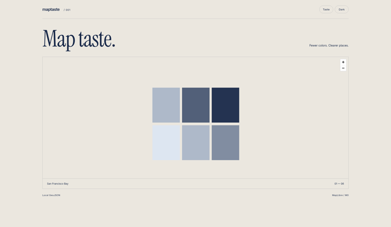
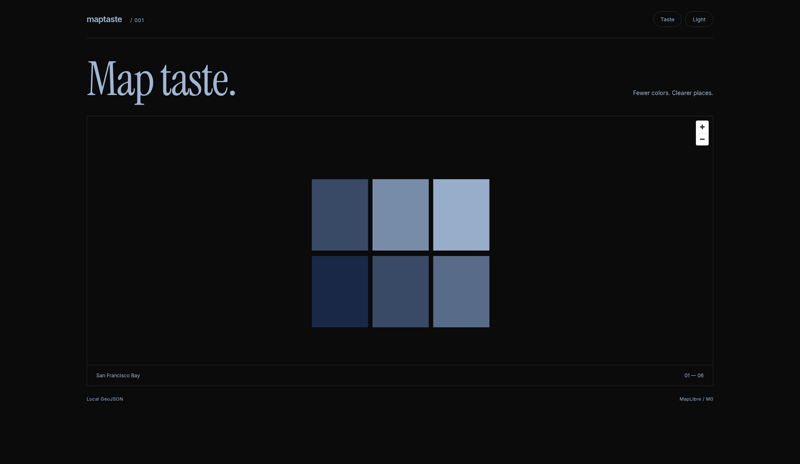

# Stop agents shipping rainbow MapLibre choropleths.

[](https://www.npmjs.com/package/maptaste)
[](https://maptaste.ledring.dev)



| Before | After | Dark |
| --- | --- | --- |
|  |  |  |

```sh
npx maptaste check style.json
```

## Check

```sh
npx maptaste check style.json --pack global
npx maptaste check style.json --pack cn
npx maptaste check style.json --pack cn --format json
```

Node 20 or newer. The four rules are heuristics. Render the map before trusting a score.

From a checkout:

```sh
pnpm install
pnpm build
node dist/cli.js check test/fixtures/bad-style.json --pack global
```

That fixture prints:

```text
ERROR MT001 layers[1].paint.fill-color: Rainbow choropleth obscures ordering; use a restrained sequential or diverging scale.
WARN MT002 layers[2].paint: Low-contrast labels need a contrasting halo or stronger text color.
…
INFO MT003 metadata: Missing dark-mode consideration; provide a dark background or declare theme variants in metadata.
WARN MT004 layers: Excessive label density; prioritize places by zoom and reduce large default text sizes.
Score: 56/100 — 1 errors, 11 warnings, 1 info
```

The skipped lines are the same MT002 warning on `layers[3]` through `layers[11]`.

Exit 0 when no finding is an error, 1 when any finding is an error, 2 when the file or the flags are invalid. Warnings and info are printed and leave the exit code at 0. `--format json` prints `{ findings, score, summary }`.

The score starts at 100. Each error subtracts 10, each warning 3, each info 1, with a floor of 0. Colors read: `#rgb`, `#rrggbb`, `rgb()`, and white, black, red, orange, yellow, green, blue, purple, cyan, including those literals inside an expression. `rgba()`, `hsl()`, zoom, and feature counts are ignored.

```ts
import { check } from 'maptaste';

const result = check({ version: 8, layers: [] }, { pack: 'global' });
```

## Skills

```sh
npx skills add FelixFangX/maptaste --skill maptaste-global
npx skills add FelixFangX/maptaste --skill maptaste-cn
```

Or copy `skills/maptaste-global` or `skills/maptaste-cn` into the agent's skills directory and tell it to follow that skill.

## Packs

Both packs use paper `#ebe7df`, void `#0b0b0b`, navy `#1a2a4a`, pale blue `#9eb6d4`.

`global` orders place names by zoom and warns above 8 text symbol layers. `cn` uses an administrative label hierarchy (行政区) and warns above 6. A dark background counts as dark mode, and so does metadata whose key contains `dark`, `theme`, or `styles` when the value is set. The skills say to leave helper labels out. The checker does not look for them.

## Rules

| ID | Default | Name | Heuristic |
| --- | --- | --- | --- |
| MT001 | error | rainbow-choropleth | Fill colors span at least four saturated hue sectors |
| MT002 | warn | label-contrast | Static label color has contrast below 4.5 against a halo or background |
| MT003 | info | dark-mode | No dark background or theme declaration in metadata |
| MT004 | warn | label-density | More than 8 text symbol layers (6 for cn), or 3 or more numeric text sizes of 24 or higher |

## Showcase

[maptaste.ledring.dev](https://maptaste.ledring.dev)

One OpenFreeMap city at pitch 57°. Before colors building height with a rainbow ramp. After uses a sequential blue ramp. Light background is `#f7f8f6`, dark is `#0b0b0b`. Light / Dark changes paint and leaves the camera. Tiles, glyphs, and sprites come from OpenFreeMap with no API key. The page needs a network connection and WebGL. Attribution stays on the map.

Presets: San Francisco, Tokyo, 上海, 外滩, London, Paris. Other place names can be English, Chinese, or another local name. `lang` sets the caption language. Workers AI expands informal names, and names Nominatim misses or mismatches (2,000 per day, 40 per IP). Sessions are capped at 5,000 per day and 20 per IP.

- https://maptaste.ledring.dev/?place=Tokyo
- https://maptaste.ledring.dev/?place=上海
- https://maptaste.ledring.dev/?place=外滩
- https://maptaste.ledring.dev/?ll=139.7671,35.6812&place=Tokyo
- https://maptaste.ledring.dev/?place=Paris&lang=zh

Try check runs this same `check` on the Rainbow fixture, the Sequential fixture, or style JSON you paste. Copy style copies the current city and camera as MapLibre style JSON. After is the default.

```sh
cd showcase
pnpm install
pnpm dev
```

## MCP

Published as `maptaste@0.0.1`.

```sh
npx -y maptaste mcp
```

Cursor or Claude Desktop:

```json
{
  "mcpServers": {
    "maptaste": {
      "command": "npx",
      "args": ["-y", "maptaste", "mcp"]
    }
  }
}
```

`maptaste-mcp` is the same server (`npx -y --package maptaste maptaste-mcp`). From a checkout: `pnpm install && pnpm build`, then `node dist/cli.js mcp` or `node dist/mcp/server.js`.

- `check_taste` takes `{ "style": {} }` or `{ "styleJson": "..." }`. The pack is global. The tool has no pack argument.
- `validate_style` checks for an object with `version` and a `layers` array.
- `preview_place` takes `place` or `ll` (`lng,lat`), and optional `zoom`, `mode` (`before` or `after`), `theme` (`light` or `dark`), and `lang`. It returns a `https://maptaste.ledring.dev/` URL. A name is resolved in the browser, so `center` is null until then.
- `preview_info` points at the local showcase: `cd showcase && pnpm install && pnpm dev`.

0.0.1. Thresholds can change in any 0.x release. Input is MapLibre style JSON.

## License

[MIT](LICENSE).
