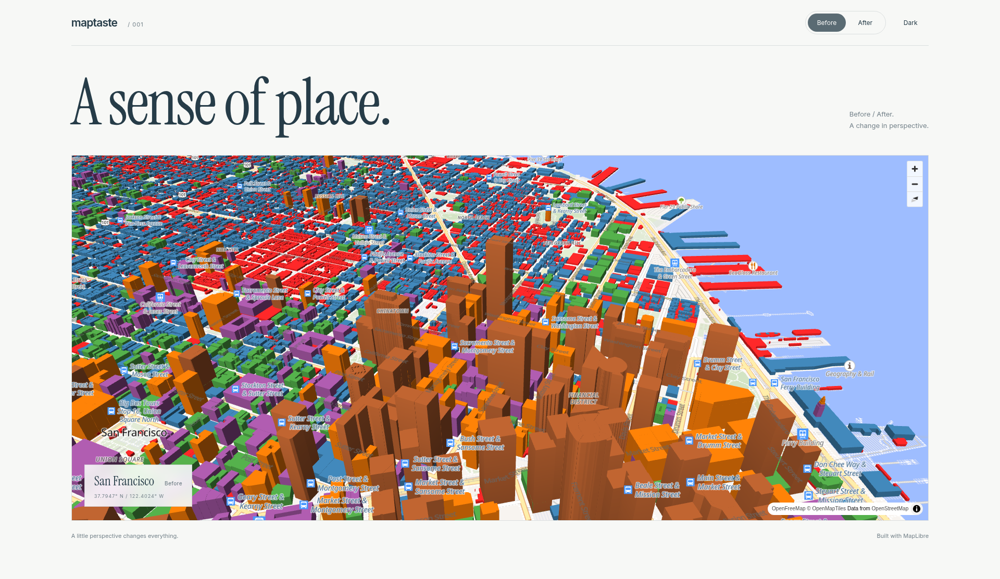
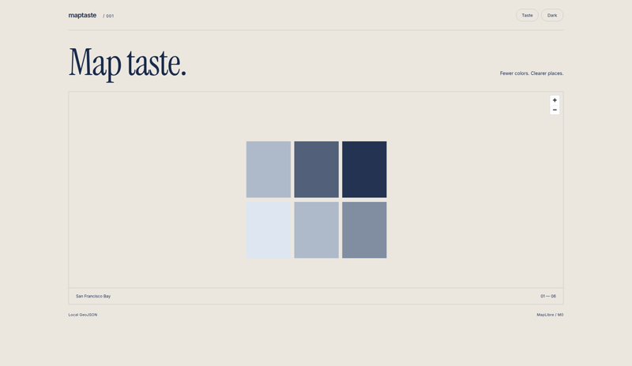
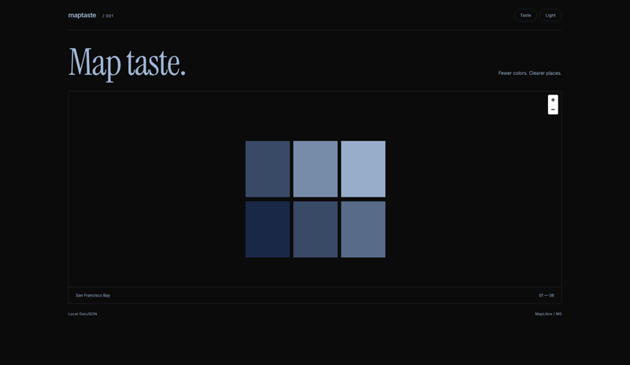
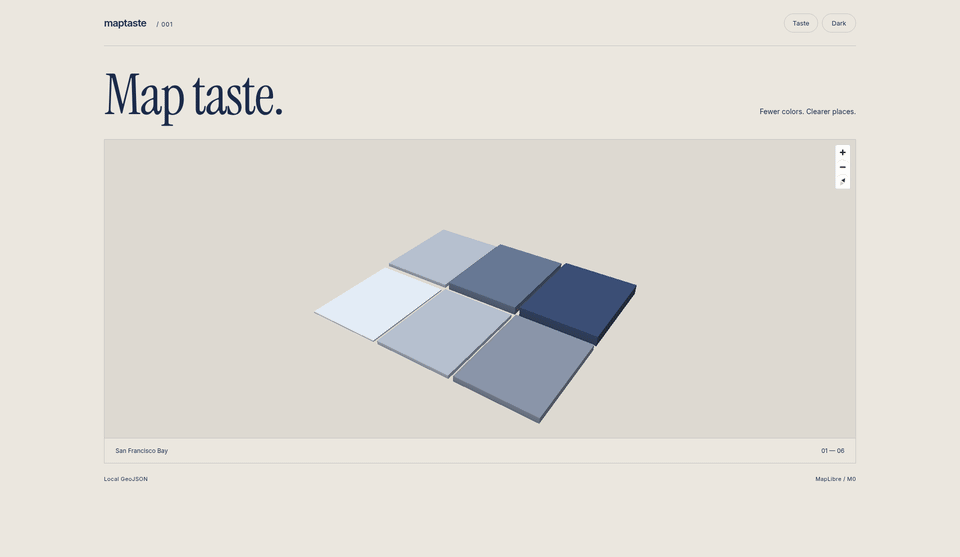

# maptaste

Two style-pack skills for coding agents, plus a `maptaste check` CLI for MapLibre style JSON, an MCP server, and a local Before / After showcase.

| Before | After | Dark |
| --- | --- | --- |
|  |  |  |



## Install the skill

Choose a pack for the map's audience:

```sh
npx skills add FelixFangX/maptaste --skill maptaste-global
npx skills add FelixFangX/maptaste --skill maptaste-cn
```

For manual installation, copy the folder from [skills/](skills/) into your agent's skills directory. Ask the agent to follow the selected skill when building or reviewing a MapLibre style.

## Check

```sh
npx maptaste check style.json --pack global
npx maptaste check style.json --pack cn
npx maptaste check style.json --pack cn --format json
```

Requires Node 20 or newer. These are taste heuristics, not a full MapLibre schema validator; expressions and real rendering still need visual review.

To run from a checkout instead, use pnpm:

```sh
pnpm install
pnpm build
node dist/cli.js check test/fixtures/bad-style.json --pack global
```

Actual output from that fixture check:

```text
ERROR MT001 layers[1].paint.fill-color: Rainbow choropleth obscures ordering; use a restrained sequential or diverging scale.
WARN MT002 layers[2].paint: Low-contrast labels need a contrasting halo or stronger text color.
…
INFO MT003 metadata: Missing dark-mode consideration; provide a dark background or declare theme variants in metadata.
WARN MT004 layers: Excessive label density; prioritize places by zoom and reduce large default text sizes.
Score: 56/100 — 1 errors, 11 warnings, 1 info
```

Exit codes: `0` passes, `1` means errors were found, and `2` means invalid input. Warnings and informational findings do not fail the command by themselves. JSON output includes `{ findings, score, summary }`.

Scores start at 100, subtract 10 per error, 3 per warning, and 1 per informational finding, with a floor of zero. Static colors support hex, `rgb()`, and common names. Dynamic colors, zoom visibility, and feature counts are not evaluated.

```ts
import { check } from 'maptaste';
const result = check({ version: 8, layers: [] }, { pack: 'global' });
```

## Packs

| Choice | global | cn |
| --- | --- | --- |
| Tokens | paper `#ebe7df`, void `#0b0b0b`, navy `#1a2a4a`, pale blue `#9eb6d4` | Same tokens |
| Choropleth | Prefer sequential or diverging scales over rainbow fills | Same |
| Labels | Place names by zoom; avoid competing text | Administrative label hierarchy (行政区); tighter label budget |
| Label density | Warn above 8 text symbol layers | Warn above 6 text symbol layers |
| Dark | Declare dark background or theme variants in metadata | Same |

Both packs treat layout as something that should explain itself. Helper-label spam is out of scope for the checker but discouraged in the skills.

## Rules

| ID | Default | Name | Heuristic |
| --- | --- | --- | --- |
| MT001 | error | rainbow-choropleth | Fill colors span at least four saturated hue sectors |
| MT002 | warn | label-contrast | Static label color has contrast below 4.5 against a halo or background |
| MT003 | info | dark-mode | No dark background or theme declaration in metadata |
| MT004 | warn | label-density | More than 8 text symbol layers (6 for cn), or 3 large text defaults |

Metadata keys containing `dark`, `theme`, or `styles` count as theme consideration.

## Showcase

Type a place or pick a preset in the showcase, or use MCP `preview_place` to open a place directly.

Agents can preview any place with the same Before/After themes using a name or coordinates. Place names may be English, Chinese, or other local proper nouns; optional `lang` shapes the caption language. Informal/meme names may be resolved via Workers AI when Nominatim misses or mismatches, under daily AI quotas (2,000 globally and 40 per IP).

- https://maptaste.ledring.dev/?place=Tokyo
- https://maptaste.ledring.dev/?place=上海
- https://maptaste.ledring.dev/?place=外滩
- https://maptaste.ledring.dev/?ll=139.7671,35.6812&place=Tokyo
- https://maptaste.ledring.dev/?place=Paris&lang=zh


A Vite + MapLibre demo on real OpenFreeMap San Francisco buildings at pitch 57°. Before pairs stock Liberty with categorical Set1 height steps. After opens by default with sequential blues, a paper or void base, and Light / Dark paint-only toggles that keep the camera.

Live: [maptaste.ledring.dev](https://maptaste.ledring.dev) (daily per-IP session quota).

```sh
cd showcase
pnpm install
pnpm dev
```

Tiles, glyphs, and sprites come from OpenFreeMap without an API key. An internet connection and WebGL are required. Map attribution stays visible.

## MCP

```sh
pnpm install && pnpm build
```

Add to Claude Desktop or Cursor (replace the absolute path, or use the `maptaste-mcp` binary after install):

```json
{
  "mcpServers": {
    "maptaste": {
      "command": "node",
      "args": ["/absolute/path/maptaste/dist/mcp/server.js"]
    }
  }
}
```

Tools: `check_taste` accepts `{ "style": {} }` or `{ "styleJson": "..." }`; `validate_style` checks object / version / layers structure; `preview_info` locates the showcase; `preview_place` returns a hosted URL from `place` or `ll` (lng,lat), with optional `zoom`, `mode`, `theme`, and `lang`. `place` accepts English, Chinese, and other local proper nouns; named places resolve in the browser; `center` is null until resolved. Validation is intentionally basic.

## Status

Early (0.x). Expect rule and pack changes between minor versions. MapLibre style JSON only for now.

## License

[MIT](LICENSE).
